# AI/ML Architecture — Bhu-Setu

## Overview

The AI/ML module converts scanned Record of Rights (RoR) / Jamabandi images into
structured, validated, explainable land records. It is designed as a clean
service boundary that the backend team can call without depending on any specific
ML framework details.

## Pipeline

```mermaid
flowchart LR
    A["Input Image"] --> B["Preprocessing"]
    B --> C["OCR Engine"]
    C --> D["OCR Post-processing"]
    D --> E["Extraction Pipeline"]
    E --> F["Normalization"]
    F --> G["Validation"]
    G --> H["Confidence / Risk Scoring"]
    H --> I["Anomaly Detection"]
    I --> J["Explainability / Evidence"]
    J --> K["AnalysisResult"]
    K --> L["FastAPI Inference API"]
    L --> M["AIInferenceClient"]
```

## Module Responsibilities

### 1. Preprocessing
- Accepts raw image paths.
- Applies image-quality normalization suitable for OCR.
- Outputs a clean `PreprocessedDocument` containing the image array and metadata.

### 2. OCR Engine
- Abstract `OCREngine` interface.
- `PaddleOCREngine` is the primary adapter for PaddleOCR 3.x.
- CPU-first by default; device is configurable.
- Lazy initialization: the engine is constructed on first use, not at import time.
- Returns structured `OCRResult` with pages, blocks, lines, words, bounding boxes,
  and per-word confidence.

### 3. OCR Post-processing
- Cleans raw OCR text.
- Normalizes whitespace, punctuation, and Devanagari digit variants.
- Removes common OCR artifacts while preserving provenance.

### 4. Extraction Pipeline
- `LabelExtractor` — matches known Hindi/English RoR labels to lines and
  extracts adjacent values.
- `PatternExtractor` — applies regex patterns for numeric fields (khasra,
  khata, khewat, khatoni, mutation number/date, area, year, revenue).
- `TableExtractor` — groups lines into candidate table rows and extracts
  parcel-level fields (khasra, area, classification, irrigation, revenue).
- `ExtractionPipeline` — orchestrates label, pattern, and table extraction,
  merges results, detects conflicts, and produces a unified `ExtractionResult`.

### 5. Normalization
- Conservative normalization used only for matching.
- Devanagari digits → Arabic digits for pattern matching.
- Whitespace and punctuation normalization.
- Extracted values preserve their original OCR text; provenance records the
  exact source.

### 6. Validation
- Checks required fields, data types, ranges, and cross-field consistency.
- Produces `validation_error_count` and `validation_warning_count`.
- Does not silently discard data; marks uncertain extractions as warnings.

### 7. Confidence / Risk Scoring
- `confidence_score` — overall pipeline confidence in [0.0, 1.0].
- `extraction_risk` — `low`, `medium`, or `high`.
  Derived from validation counts, extraction confidence, and field coverage.

### 8. Anomaly Detection
- `AnomalyModel` — Isolation Forest based anomaly detector.
- Optional: if no model is configured, `anomaly_score`, `anomaly_risk`, and
  `anomaly_features` are `None`.
- When configured, produces a scalar anomaly score and risk classification.

### 9. Explainability / Evidence
- `explainability_evidence` — JSON-serializable evidence about which fields
  influenced scoring or extraction.
- `FieldProvenance` — per-field traceability: source OCR text, bounding box,
  page number, OCR confidence, extraction confidence, method, extractor version.

### 10. AnalysisResult
- The AI domain source of truth.
- Contains `extraction_result`, `confidence_score`, `extraction_risk`,
  `anomaly_score`, `anomaly_risk`, `anomaly_features`, and
  `explainability_evidence`.

## Important Schemas

### OCRResult
- `pages[]` — each page has `blocks[]`, `blocks[]` have `lines[]`,
  `lines[]` have `words[]`.
- Each `OCRWord` has `text`, `confidence`, `bbox`, `language`.
- Engine name and language are preserved.

### ExtractionResult
- `status` — `success`, `partial`, or `failure`.
- `metadata` — document-level fields (document_id, state, district, tehsil,
  village, year, document_type, khata_number, khewat_number, khatoni_number,
  mutation_number, mutation_date, mutation_details).
- `landholders[]` — name, father_or_husband_name, caste, address, share,
  is_cultivator.
- `parcels[]` — khasra_number, area_raw, area_normalized, area_unit,
  land_classification, land_type, cultivation_status, irrigation_source,
  revenue, remarks.
- `unrecognized_text[]`, `warnings[]`, `conflicts[]`.
- `validation_error_count`, `validation_warning_count`.

### AnalysisResponse (API)
- Wraps `ExtractionResult` with top-level confidence, risk, anomaly, and
  explainability fields.
- Stable fields: `extraction_result.status`, metadata keys, landholder keys,
  parcel keys, `confidence_score`, `extraction_risk`, `anomaly_score`,
  `anomaly_risk`, `explainability_evidence` (top-level).
- Evolving fields: `anomaly_features` (opaque vector), inner structure of
  `explainability_evidence`.

## Extraction Methods

- `label` — extracted via known RoR label matching.
- `regex` — extracted via regex patterns.
- `spatial` — extracted via position-based heuristics.
- `table` — extracted via table row grouping.
- `ml` — extracted via ML model.
- `llm` — extracted via LLM (not currently used).
- `manual` — manually entered.
- `unknown` — method could not be determined.

## Provenance / Evidence Handling

Every extracted field can carry a `FieldProvenance` record:
- `source_ocr_text` — exact OCR text from which the value was derived.
- `source_bbox` — bounding box of the source text.
- `page_number` — page where the text was found.
- `ocr_confidence` — OCR engine confidence for the source text.
- `extraction_confidence` — confidence that the extracted value is correct.
- `extraction_method` — which extractor produced the value.
- `extractor_version` — version of the extractor.
- `notes` — free-text notes.

Provenance is preserved in API responses under the `value.provenance` key.

## Confidence Calculation

Confidence is derived from:
- OCR confidence of source words.
- Extraction method reliability.
- Validation outcomes.
- Field coverage (how many expected fields were found).

`confidence_score` is a single float in [0.0, 1.0].
`extraction_risk` is `low`, `medium`, or `high`.

## Validation and Conflict Handling

- Validation checks required fields, types, ranges, and cross-field consistency.
- Conflicts arise when multiple extractors produce different values for the same
  field. They are recorded in `conflicts[]` and surfaced in the API response.
- Validation errors block auto-approval; warnings require human review.

## Isolation Forest Anomaly Detection

- `AnomalyModel` wraps scikit-learn's `IsolationForest`.
- Features are derived from extraction statistics.
- `anomaly_score` is the raw model output; higher positive values indicate
  anomaly.
- `anomaly_risk` is discretized into `low`, `medium`, `high`..

## Human-in-the-Loop Concept

- Low confidence or high risk results should be routed to human review.
- The API surface is designed for the backend team to build review workflows on
  top of; the AI module does not implement review UI or approval logic.

## API Integration Boundary

- Primary endpoint: `POST /api/v1/inference/document`
- Accepts `multipart/form-data` with `file` field (image: png, jpg, jpeg, bmp, tiff, tif; max 20 MB).
- Returns `AnalysisResponse` JSON matching `AnalysisResponseSchema`.
- Error contract: `{ "error": "snake_case_code", "message": "..." }` (ErrorResponseSchema).
- Status codes: 200, 400, 422, 500. (413/503 not explicitly implemented).
- Client library: `AIInferenceClient` in `ai_ml/client/`.

## Current Limitations

- Windows CPU inference with PaddleOCR 3.x is impractically slow due to
  upstream PaddlePaddle/oneDNN runtime issues. Real inference is currently
  feasible only on Linux/WSL/cloud environments with GPU or optimized CPU builds.
- PDF input is not yet supported.
- The benchmark and ground-truth evaluation frameworks are ready but require
  manually prepared local images and JSON files.
- Synthetic evaluation fixtures do not represent real-world OCR accuracy.
- No production authentication, RBAC, database, or frontend implementation.

## Synthetic vs Real-World Evaluation

- **Synthetic evaluation** — uses fixture data in `ai_ml/tests/` and
  `ai_ml/evaluation/synthetic.py`. Fast, deterministic, and used for CI.
  Does **not** represent real-world OCR accuracy.
- **Real-world benchmark** — requires local RoR images and manually prepared
  ground-truth JSON files. Use `ai_ml/evaluation/benchmark.py` and
  `ai_ml/evaluation/ground_truth.py`. Results are genuine only when real images
  and PaddleOCR inference are available.

## Requirements for Real-World Benchmarking

- Linux/WSL/cloud environment with working PaddleOCR inference.
- Local RoR/Jamabandi images stored outside Git.
- Manually prepared ground-truth JSON files.
- Sufficient CPU/GPU resources for PaddleOCR model inference.
- No automatic downloads; models must be pre-cached.
