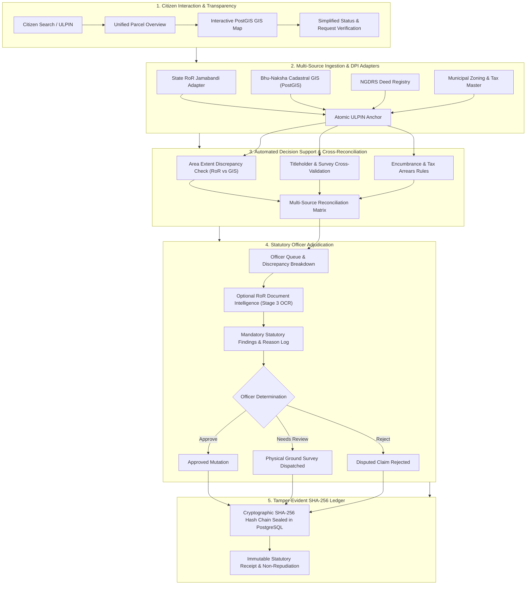

# Stage 5: End-to-End Parcel Governance Demo Workflow

> **Problem Statement 26014 (SIH 2026)**: *“An Integrated GIS-based Digital Public Infrastructure for Land Governance.”*  
> **Milestone**: Stage 5 — Complete End-to-End Parcel Governance Demo Workflow  
> **Status**: Completed  
> **Branch**: `feature/stage4-parcel-gis-reconciliation`  

---

## 1. Executive Summary & Architecture

**Bhu-Setu** (*Digital Bridge for Land Public Infrastructure*) solves the fragmentation of Indian land administration by creating an atomic, parcel-centric Digital Public Infrastructure (DPI) linking three historically isolated pillars:
1. **State Record of Rights (Bhulekh / Jamabandi / Patta)** — Textual revenue records and titleholder claims.
2. **Bhu-Naksha Cadastral GIS** — Georeferenced PostGIS boundary polygons (EPSG:4326).
3. **NGDRS Deed Registration** — Sub-Registrar transactions and legal deeds.

### The 5-Stage Decision Lifecycle Architecture

---

## 2. Interactive Judge Demo Switcher Parcels

The prototype includes four representative synthetic parcels engineered to demonstrate distinct governance scenarios:

| ULPIN / ULPID | Location | Titleholder | Scenario & Verification Findings | Status |
| :--- | :--- | :--- | :--- | :--- |
| **`PB-LDH-0042`** *(Primary Demo)* | Burj Littan, Ludhiana, Punjab | Ramesh Kumar | **Area Mismatch**: RoR records 1,250 sqm, while PostGIS cadastral polygon calculates 1,180 sqm (**70 sqm / 5.6% variance**). Flags discrepancy for officer adjudication. | `Needs Verification` / `Under Review` |
| **`PB-LDH-0044`** | Burj Littan, Ludhiana, Punjab | Harpreet Kaur | **Clean Multi-Source Sync**: RoR (1,180 sqm), GIS Polygon (1,180 sqm), and NGDRS Deed match with 0.0% variance. Immediate statutory approval ready. | `Verified` |
| **`PB-LDH-0043`** | Gill, Ludhiana, Punjab | Suresh Singh | **Encumbrance / Tax Arrears**: Agricultural land with ₹3,200 municipal tax dues requiring clearance before mutation. | `Needs Verification` |
| **`CH-SEC-1701`** | Sector 17, Chandigarh (UT) | Rajiv Mehta | **Commercial High-Density**: Multi-tenant parcel with master plan commercial zoning compliance. | `Verified` |

> [!NOTE]
> All data is explicitly labeled **`[DEMO / SYNTHETIC DATA]`** to maintain strict integrity. Automated checks provide decision support; authorized officials make final statutory decisions.

---

## 3. End-to-End Step-by-Step Demonstration Walkthrough

### Step 1: Citizen Discovery & Parcel Record
- **URL**: `http://localhost:3000/parcel/PB-LDH-0042` (or `/parcels`)
- **Actions**:
  1. Open the parcel page. Observe the **Judge Demo Switcher Bar** at the top allowing instant switching between demo parcels.
  2. Notice the **Unified Parcel Flow Banner** visualizing the 3 data adapters (State RoR, Bhu-Naksha Cadastre, NGDRS Registry) feeding into the atomic ULPIN `PB-LDH-0042`.
  3. Inspect the **6-Category Reconciliation Summary Matrix**:
     - *Area Extent*: Mismatch (1,250 sqm declared vs 1,180 sqm surveyed).
     - *Survey / Khasra*: Matched (`142/3`).
     - *Titleholder*: Matched (`Ramesh Kumar`).
     - *Deed Registration*: Matched (`NGDRS #PB-2024-REG-981`).
     - *Encumbrance / Liens*: Nil Encumbrance.
     - *Master Plan Zoning*: Compliant Residential.
  4. View the **Interactive PostGIS Map** displaying the colored polygon and adjacent cadastre plots.
  5. Click **"Request Verification"** to open the citizen verification modal and generate a tracking receipt (`REQ-2026-PB-XXXX`).

### Step 2: Role-Based Access Control (RBAC) Guard
- If authenticated as a **Citizen**, accessing `/officer/mutations` renders an alert:
  - *"Role-Based Access Notice: Authenticated as 'citizen'. Citizens cannot perform mutation decisions (HTTP 403 Forbidden)."*
  - Switch demo persona via the `/login` portal to **Revenue Officer** (`OFF-102`).

### Step 3: Statutory Officer Adjudication
- **URL**: `http://localhost:3000/officer/mutations?ulpid=PB-LDH-0042`
- **Actions**:
  1. Inspect the pre-populated target parcel profile and multi-source variance flags.
  2. Review the 5-Stage Decision Lifecycle timeline.
  3. Select **"Needs Review"** (or **"Approve Mutation"** / **"Reject Mutation"**).
  4. Notice that **Official Statutory Notes** are mandatory: submitting without notes triggers validation warnings.
  5. Click **"Submit & Record Mutation Decision"** $\rightarrow$ Confirm dialog appears with statutory summary.

### Step 4: Tamper-Evident SHA-256 Audit Seal
- Upon confirmation:
  1. Backend computes SHA-256 hash chaining `parcel_id`, `decision`, `officer_id`, `notes`, `timestamp`, and `previous_hash`.
  2. The UI renders the **Green Mutation Recorded Certificate** with:
     - Target Parcel ULPID
     - Decision (`NEEDS REVIEW` / `APPROVED`)
     - Adjudicating Officer (`OFF-102`)
     - Official Notes
     - Formatted ISO Timestamp
     - 64-character SHA-256 Audit Hash with One-Click Copy button.
  3. Links seamlessly back to Citizen Parcel View to observe updated status.

---

## 4. SIH 2026 Problem Statement 26014 Alignment

| SIH 2026 Requirement | Bhu-Setu Implementation | Verification Evidence |
| :--- | :--- | :--- |
| **Integrated GIS & Digital Public Infrastructure** | PostGIS spatial layer with GeoJSON polygons, bounding boxes, and centroids integrated with revenue tables. | `backend/src/services/gisService.ts`, Leaflet map viewer |
| **Multi-Source Data Harmonization** | 3 independent DPI adapters (State RoR, Cadastral GIS, NGDRS Registry) linked to atomic ULPIN. | `backend/src/services/parcelReconciliationService.ts`, `UnifiedParcelFlow.tsx` |
| **Explainable Discrepancy Detection** | Rule-based engine comparing area, ownership, survey numbers, and liens with plain-English rationales. | `/api/parcel/:ulpid/reconciliation`, `frontend/components/UnifiedParcelFlow.tsx` |
| **AI / OCR Decision Support Boundary** | Jamabandi RoR OCR document intelligence informs without replacing human authority. | `POST /api/ocr/extract`, statutory disclaimers on all pages |
| **Statutory Non-Repudiation & Audit Trail** | Cryptographic SHA-256 hash chaining on every official determination stored in PostgreSQL. | `backend/src/services/hashChain.ts`, `backend/src/db/migrations/002_create_mutations.sql` |
| **Citizen Empowerment & Transparency** | Clear, jargon-free lifecycle badges, verification request modals, and public search. | `frontend/app/parcel/[ulpid]/page.tsx`, `frontend/app/parcels/page.tsx` |

---

## 5. Summary of Key Files

- **Unified Flow Component**: `frontend/components/UnifiedParcelFlow.tsx`
- **Citizen Parcel Details**: `frontend/app/parcel/[ulpid]/page.tsx`
- **Officer Mutation Adjudication**: `frontend/app/officer/mutations/page.tsx`
- **Integration Test Suite**: `backend/tests/integration/stage5GovernanceWorkflow.test.ts`
- **Demo Documentation**: `docs/stage5-end-to-end-demo.md`
