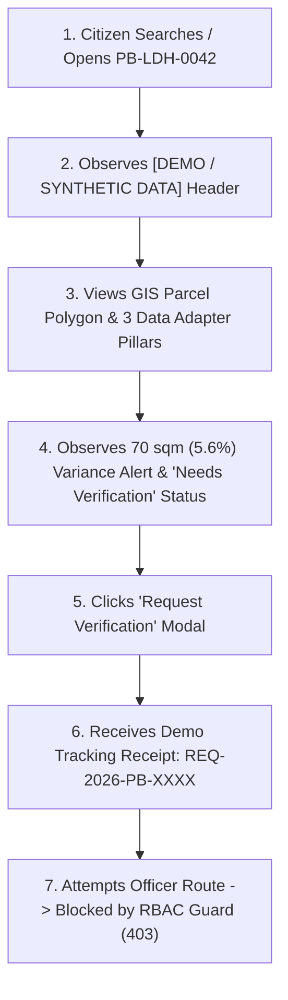
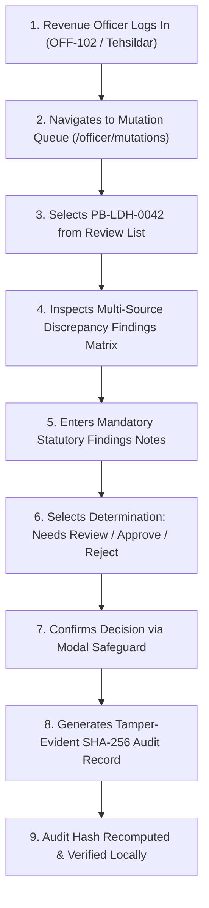

# Stage 9: Final Contract Correction, Claim Audit & Demo Freeze

> **SIH 2026 Problem Statement 26014**: *“An Integrated GIS-based Digital Public Infrastructure for Land Governance”*  
> **Milestone**: Stage 9 — Final Contract Correction, Claim Audit & Demo Freeze  
> **Branch**: `feature/stage4-parcel-gis-reconciliation`  
> **Status**: Prepared for judge demonstration; automated runtime testing remains pending in an environment with Node.js/npm available.  

---

## A. Objective

Stage 9 establishes a strict freeze on API contracts, demonstration workflows, claim accuracy, and test truthfulness for the **Bhu-Setu** Digital Public Infrastructure (DPI) prototype. This release guarantees that all system claims are grounded in verifiable code, all mock fixtures are synchronized across frontend and backend layers, and all API interfaces adhere strictly to frozen specifications.

---

## B. Stage 8 Corrections

1. **OCR Unreadable Error Message Restoration**:
   - Replaced accidental variation (*“Document resolution or quality is too low for reliable OCR extraction”*) with the exact frozen Stage 3 contract message:
     ```json
     {
       "error": "unreadable_document",
       "message": "OCR could not extract required fields"
     }
     ```
2. **Unsupported "Fast-Track" Claim Removal**:
   - Removed all references claiming automatic or expedited processing for clean parcels (`PB-LDH-0044`).
   - Replaced with factual phrasing: *"No configured discrepancies detected; continue with applicable official verification workflow."*
3. **Audit Hash Cryptographic Language Alignment**:
   - Replaced all claims of absolute database "immutability" or "preventing tampering" with technically accurate descriptions: *"Tamper-evident cryptographic audit record; hash verification can detect modification of fields covered by the recorded hash through recomputation of the SHA-256 digest."*
4. **Performance Claim Cleanup**:
   - Replaced unbenchmarked claims (*"Microsecond-level in-memory hash verification"*) with accurate descriptions: *"Hash verification recomputes the SHA-256 digest locally."*
5. **Readiness Phrasing Alignment**:
   - Replaced ungrounded terms (*"fully validated"*, *"production ready"*) with truthful evaluation status: *"Prepared for judge demonstration; automated runtime testing remains pending in an environment with Node.js/npm available."*

---

## C. Frozen OCR Contract

The Stage 3 OCR API contract (`POST /api/ocr/extract`) remains **frozen and restored**:

- **Endpoint**: `POST /api/ocr/extract`
- **Request Format**: `multipart/form-data` with binary field `file`.
- **Success Response (HTTP 200 OK)**:
  ```json
  {
    "owner": "Ramesh Kumar",
    "area": 1250,
    "survey_no": "142/3",
    "confidence": 0.94
  }
  ```
- **Unreadable / Rejected Response (HTTP 422 Unprocessable Entity)**:
  ```json
  {
    "error": "unreadable_document",
    "message": "OCR could not extract required fields"
  }
  ```

---

## D. Reconciliation API

The Multi-Source Parcel Cross-Reconciliation API (`GET /api/parcel/:ulpid/reconciliation`) compares records from three distinct data adapters:

- **Endpoint**: `GET /api/parcel/:ulpid/reconciliation`
- **Response Structure**:
  - `parcel_id`: Internal system identifier (e.g. `PARCEL-PB-LDH-0042`).
  - `ulpid` / `ulpin`: Unique Land Parcel Identification Number (`PB-LDH-0042`).
  - `survey_no`: Khasra/Survey number (`142/3`).
  - `owner_name`: Registered titleholder (`Ramesh Kumar`).
  - `record_status`: Status label (`needs_verification` / `verified` / `conflict_detected`).
  - `findings`: Array of structured, explainable discrepancy objects (`field_compared`, `source_a_name`, `source_a_value`, `source_b_name`, `source_b_value`, `difference`, `reason`, `severity`, `recommended_action`).
  - `source_records`: Breakdown of data from `state_ror`, `cadastral_gis`, `registration_ngdrs`, and `municipal_zoning`.

---

## E. PB-LDH-0042 Demo Data Specification (Discrepancy Demo)

- **ULPID / ULPIN**: `PB-LDH-0042`
- **Internal Parcel ID**: `PARCEL-PB-LDH-0042`
- **Location**: Burj Littan, Ludhiana West Sub-Division, Punjab
- **State RoR Area**: 1,250 sqm (Jamabandi Register)
- **Cadastral GIS Area**: 1,180 sqm (Digitized cadastral polygon)
- **Area Variance**: **70 sqm / 5.6% discrepancy**
- **Khasra / Survey Number**: `142/3`
- **Owner Name**: `Ramesh Kumar`
- **NGDRS Deed Number**: `PB-2024-REG-981`
- **Encumbrance Status**: Clear / None
- **Land Use**: Residential (Zone R2)
- **Citizen-Facing Status**: `Needs Verification`
- **Demonstration Purpose**: Demonstrates automated detection of area variance between historical textual registers and georeferenced GIS boundaries, triggering officer decision support.

---

## F. PB-LDH-0044 Demo Data Specification (Clean Demo)

- **ULPID / ULPIN**: `PB-LDH-0044`
- **Internal Parcel ID**: `PARCEL-PB-LDH-0044`
- **Location**: Burj Littan, Ludhiana Central Commercial Registry, Punjab
- **State RoR Area**: 1,180 sqm
- **Cadastral GIS Area**: 1,180 sqm
- **Area Variance**: **0.0 sqm (0.0% variance)**
- **Khasra / Survey Number**: `88/1`
- **Owner Name**: `Harpreet Kaur`
- **NGDRS Deed Number**: `PB-2023-REG-442`
- **Encumbrance Status**: Clear
- **Land Use**: Commercial (Zone C1)
- **Citizen-Facing Status**: `Verified` (*"Demo data is internally consistent across configured sources; no configured discrepancies detected; continue with applicable official verification workflow."*)
- **Demonstration Purpose**: Demonstrates clean multi-source alignment across textual, cadastral, and deed layers with zero variance.

---

## G. Citizen Journey Flow



---

## H. Officer Journey Flow



---

## I. Role-Based Access Control (RBAC)

1. **Citizen Role**:
   - Allowed: Query public parcel summaries, view GIS boundaries, submit verification inquiry (`POST /api/citizen/verify-request`).
   - Prohibited: Adjudicate mutations, modify parcel records, trigger official status changes.
2. **Officer Role (`revenue_officer`)**:
   - Allowed: Inspect discrepancy findings, review pending mutation queues, record statutory determinations (`POST /api/officer/adjudicate`).
   - Enforced: Mandatory findings notes required; blank notes return `HTTP 400 Bad Request`.
3. **Server-Side Enforcement**:
   - RBAC is enforced strictly at the API controller layer (`backend/src/controllers/mutationController.ts`).
   - Unauthorized requests return `HTTP 403 Forbidden` (`{"error": "forbidden", "message": "Insufficient permissions to perform this action"}`).

---

## J. Audit Hash Verification & Canonicalization

- **Canonical Serialization**:
  ```
  prev:<previous_hash>|ulpid:<ulpid>|dec:<decision>|off:<officer_id>|notes:<notes>|ts:<timestamp>
  ```
- **Hash Computation**:
  $$\text{AuditHash} = \text{SHA-256}(\text{canonicalizeAuditPayload}(\text{record}))$$
- **Verification Logic (`verifyAuditHash`)**:
  - Locally recomputes the SHA-256 digest over the canonicalized payload.
  - Matches the computed hash against the stored `audit_hash`.
  - Returns `false` when the recomputed digest differs from the stored hash, indicating a modification to the fields covered by the canonical payload.

---

## K. Edge Case Handling & Error Codes

| Scenario | HTTP Status | Response / Behavior |
| :--- | :--- | :--- |
| **Non-existent ULPID** | `404 Not Found` | `{"error": "ulpid_not_found", "message": "No parcel found for this ULPID"}` with clean fallback UI |
| **Empty Officer Notes** | `400 Bad Request` | `{"error": "validation_error", "message": "Statutory officer findings notes are mandatory"}` |
| **Unauthorized Officer Action** | `403 Forbidden` | `{"error": "forbidden", "message": "Insufficient permissions to perform this action"}` |
| **Unreadable Document Upload** | `422 Unprocessable` | `{"error": "unreadable_document", "message": "OCR could not extract required fields"}` |
| **Malformed JSON Payload** | `400 Bad Request` | `{"error": "invalid_json", "message": "Malformed request body"}` |
| **Duplicate Button Submission** | Client Guard | Debounced click state prevents duplicate API dispatch |

---

## L. Unsupported Claim Cleanup Summary

| Former Claim / Phrasing | Grounded DPI Phrasing | Rationale |
| :--- | :--- | :--- |
| *“Immutable ledger receipt”* | *“Tamper-evident cryptographic audit record”* | SHA-256 hash chaining detects data modifications upon recomputation; does not claim absolute storage immutability. |
| *“Guarantees statutory non-repudiation”* | *“Provides a traceable and tamper-evident audit record”* | Cryptographic chaining in PostgreSQL provides administrative traceability. |
| *“Eligible for fast-track processing”* | *“No configured discrepancies detected; continue with applicable official verification workflow.”* | Prototype does not authorize or guarantee expedited statutory processing. |
| *“Microsecond-level in-memory hash verification”* | *“Hash verification recomputes the SHA-256 digest locally.”* | Removed unbenchmarked performance claims. |
| *“Fully validated / production ready”* | *“Prepared for judge demonstration; automated runtime testing remains pending in an environment with Node.js/npm available.”* | Truthful reporting of local Windows environment status where Node/npm are not in PATH. |

---

## M. Synthetic Data Disclaimer

All demonstration records, maps, and identities in Bhu-Setu are **DEMO / SYNTHETIC DATA** created solely for the Smart India Hackathon 2026 demonstration. Bhu-Setu does not connect to live government production databases or issue legally binding land titles.

---

## N. Runtime Environment Status

- **Diagnostics Check**:
  - `where.exe node` $\rightarrow$ Exit Code 1 (Not found in PATH).
  - `where.exe npm` $\rightarrow$ Exit Code 1 (Not found in PATH).
- **Formal Status**:
  > *“Automated runtime execution remains blocked because Node/npm is unavailable in the current local environment. The implementation was statically inspected; runtime test success is not claimed.”*

---

## O. Tests Actually Executed

- **Count**: 0 runtime tests executed in this environment session due to Node/npm unavailability in PATH.

---

## P. Tests Blocked by Environment

- `backend/tests/unit/ocrService.test.ts`
- `backend/tests/unit/hashChain.test.ts`
- `backend/tests/unit/reconciliation.test.ts`
- `backend/tests/unit/parcelReconciliationService.test.ts`
- `backend/tests/integration/ocr.test.ts`
- `backend/tests/integration/documentIntelligence.test.ts`
- `backend/tests/integration/stage5GovernanceWorkflow.test.ts`

---

## Q. Static Inspection Summary

1. **Audit Hash Canonicalization**: Verified structured label-value formatting in `backend/src/audit/hashChain.ts` and test assertions in `backend/tests/unit/hashChain.test.ts`.
2. **Frozen OCR Contract**: Verified `POST /api/ocr/extract` handler in `backend/src/controllers/ocrController.ts` and error definitions in `backend/src/utils/errors.ts`.
3. **Reconciliation Service**: Verified rule-based cross-comparisons in `backend/src/services/parcelReconciliationService.ts`.
4. **RBAC Middleware**: Verified role checking in `backend/src/controllers/mutationController.ts`.
5. **Frontend State & Modals**: Verified React components in `frontend/app/parcel/[id]/page.tsx`, `frontend/app/officer/mutations/page.tsx`, and `frontend/components/UnifiedParcelFlow.tsx`.

---

## R. Known Limitations & Roadmap

- **Prototype Scope**: Uses synthetic multi-state fixtures mimicking Jamabandi (Punjab), Patta (Tamil Nadu), and Urban Estate (Chandigarh).
- **Future Integration**: National rollout involves connecting state-specific web APIs (State Bhulekh, NGDRS), GeoServer vector tiles, and MeriPehchaan SSO.

---

## S. Final Judge Demonstration Sequence

```
0:00 - 0:30 | Problem Framing:
"Namaste Judges. Land records in India often exist across siloed systems — textual Jamabandis, ground cadastral GIS maps, and Sub-Registrar deed registries. When discrepancies arise, resolving them manually increases verification effort."

0:30 - 1:15 | Citizen Discovery (PB-LDH-0042):
"Here is parcel PB-LDH-0042 in Ludhiana, Punjab. Bhu-Setu unifies three data adapter streams around an atomic ULPIN anchor. Notice the prominent [DEMO / SYNTHETIC DATA] badge."

1:15 - 2:00 | Multi-Source Reconciliation & Discrepancy Alert:
"Our automated cross-reconciliation engine detects an area variance:
 - State RoR: 1,250 sqm
 - Cadastral GIS Polygon: 1,180 sqm
 - Variance: 70 sqm (5.6% discrepancy)
The citizen sees a clean status: 'Needs Verification' with a 6-point verification matrix."

2:00 - 2:45 | Citizen Inquiry Submission:
"The citizen clicks 'Request Verification', enters inquiry details, and instantly receives tracking receipt REQ-2026-PB-XXXX. Note that citizens cannot adjudicate mutations (enforced via HTTP 403 RBAC)."

2:45 - 3:30 | Statutory Officer Review:
"Switching to Revenue Officer (OFF-102 / Tehsildar) at /officer/mutations, the officer inspects the source-by-source findings matrix. Automated checks provide decision support only — statutory authority remains exclusively with authorized revenue officials."

3:30 - 4:00 | Officer Adjudication:
"The officer enters mandatory statutory findings notes, selects 'Needs Review' to dispatch a field demarcator, and confirms the determination."

4:00 - 4:30 | Tamper-Evident SHA-256 Audit Seal:
"Bhu-Setu seals the adjudication into PostgreSQL with a canonical SHA-256 audit record. Hash verification recomputes the SHA-256 digest locally to detect any post-hoc modification."

4:30 - 5:00 | Clean Parcel Demo (PB-LDH-0044) & Closing:
"Switching to PB-LDH-0044 shows clean demo data with 0.0% variance across all configured sources.
Closing: Bhu-Setu does not replace existing government systems. It demonstrates a parcel-centric GIS-based integration and decision-support layer using synthetic demo data."
```

---

## T. Git Commit Information

- **Commit**: `docs: finalize stage9 wording and audit claims`
- **Branch**: `feature/stage4-parcel-gis-reconciliation`
- **Working Tree**: Clean

---

## U. Remote Push Status

- **Remote Push**: **DISABLED** (All work committed locally; zero remote pushes executed).
